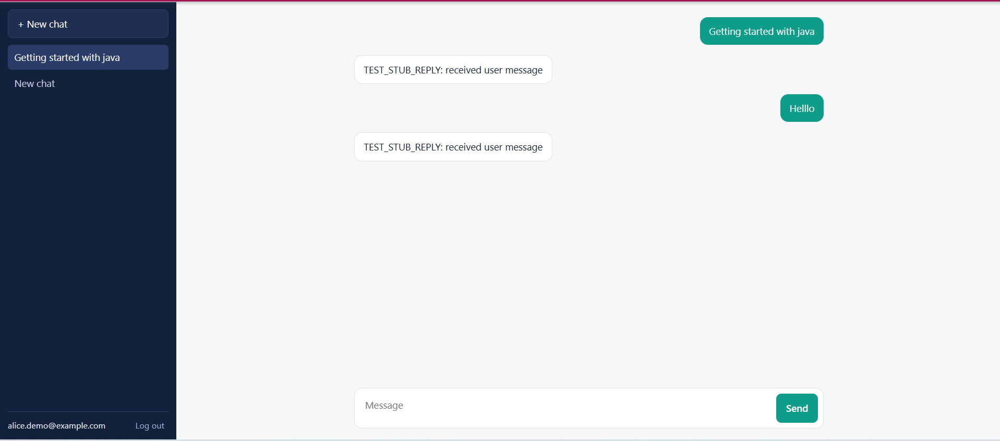

# RR-ChatBot

A full-stack chatbot application built with **Java 17, Spring Boot,
PostgreSQL, and a vanilla HTML/CSS/JavaScript frontend**, with a
separate **Python AI webhook service**.

## Application Screenshot



The repository supports two workflows:

1.  **Local development and QA** --- run the Java backend, Python
    webhook, and PostgreSQL locally, either directly or with Docker
    Compose.
2.  **Hosted deployment** --- deploy the Java and Python containers as
    two independent services on Render, with PostgreSQL hosted
    separately (for example, on Neon).

> **Current AI implementation:** The Python service is a deterministic
> integration-test stub. It validates the webhook request and returns a
> fixed test response. It does not call an LLM or a real AI provider.

------------------------------------------------------------------------

## Table of contents

-   [Architecture](#architecture)
-   [Technology stack](#technology-stack)
-   [Repository structure](#repository-structure)
-   [Application features](#application-features)
-   [Prerequisites](#prerequisites)
-   [Local development](#local-development)
    -   [Option A: Docker Compose](#option-a-docker-compose)
    -   [Option B: Run services
        directly](#option-b-run-services-directly)
-   [Environment variables](#environment-variables)
-   [Production deployment on Render](#production-deployment-on-render)
-   [Frontend and API routing](#frontend-and-api-routing)
-   [Testing and database
    verification](#testing-and-database-verification)
-   [Troubleshooting](#troubleshooting)
-   [Security and production
    limitations](#security-and-production-limitations)

------------------------------------------------------------------------

## Architecture

### Logical architecture

``` text
                         Browser
                            |
                         HTTPS
                            |
                            v
              +---------------------------+
              | Java Spring Boot service |
              |                           |
              | - Serves frontend files   |
              | - Authentication         |
              | - Chat and message APIs  |
              | - Authorization          |
              +---------------------------+
                    |              |
             JDBC / TLS       HTTPS webhook
                    |              |
                    v              v
          +----------------+  +----------------------+
          | PostgreSQL     |  | Python AI service    |
          | (e.g. Neon)    |  |                      |
          |                |  | - GET /health        |
          | users          |  | - POST /ai           |
          | chats          |  | - Shared-secret check|
          | messages       |  | - Test response      |
          +----------------+  +----------------------+
```

### Local Docker Compose networking

When both containers are run through Docker Compose, the Java container
reaches Python using the Compose service name:

``` text
http://python-ai:8090/ai
```

Do not use `localhost` or `127.0.0.1` for container-to-container
communication. Inside a container, those addresses refer to that same
container.

### Hosted Render networking

The hosted services are independent. The Java service calls the Python
service using its public HTTPS URL and the `X-Webhook-Secret` header.

Current service URLs:

  -----------------------------------------------------------------------------------
  Service                             URL
  ----------------------------------- -----------------------------------------------
  Java application and frontend       https://rr-chatbot-java.onrender.com

  Python webhook                      https://rr-chatbot-python.onrender.com

  Python health endpoint              https://rr-chatbot-python.onrender.com/health

  Python AI endpoint                  https://rr-chatbot-python.onrender.com/ai
  -----------------------------------------------------------------------------------

The browser should call the Java service only. It should not call the
Python webhook directly and must never receive the webhook secret.

------------------------------------------------------------------------

## Technology stack

  -----------------------------------------------------------------------
  Layer                   Technology              Responsibility
  ----------------------- ----------------------- -----------------------
  Backend                 Java 17                 Application and
                                                  business logic

  Backend framework       Spring Boot             HTTP server and REST
                                                  APIs

  Persistence             Spring Data JPA /       Database access and ORM
                          Hibernate               

  Database                PostgreSQL              Users, chats, messages
                                                  and related data

  Hosted database option  Neon PostgreSQL         Managed PostgreSQL
                                                  hosting

  Frontend                HTML, CSS, vanilla      Browser UI
                          JavaScript              

  AI integration service  Python                  Webhook contract and
                                                  response generation

  Containerization        Docker                  Package Java and Python
                                                  independently

  Local orchestration     Docker Compose          Run both containers
                                                  together locally

  Build                   Maven                   Compile, test and
                                                  package Java

  Hosting                 Render                  Host the Java and
                                                  Python web services
  -----------------------------------------------------------------------

The frontend is packaged inside the Spring Boot application under:

``` text
java-backend/src/main/resources/static/
```

A separate frontend hosting service is not required for this
architecture.

------------------------------------------------------------------------

## Repository structure

The following is the intended source layout. Build output such as
`target/` is generated and should not be treated as source code.

``` text
RR-ChatBot/
│
├── java-backend/
│   ├── Dockerfile
│   ├── .dockerignore
│   ├── pom.xml
│   ├── src/
│   │   ├── main/
│   │   │   ├── java/
│   │   │   │   └── com/example/chatbot/
│   │   │   └── resources/
│   │   │       ├── application.yml
│   │   │       └── static/
│   │   │           ├── index.html
│   │   │           ├── login.html
│   │   │           ├── chat.html
│   │   │           ├── css/
│   │   │           ├── js/
│   │   │           └── assets/
│   │   └── test/
│   │       └── java/com/example/chatbot/
│   ├── target/                 # Generated by Maven; do not commit
│   └── test-results/           # Generated test reports, if produced
│
├── python-ai/
│   ├── Dockerfile
│   ├── .dockerignore
│   ├── requirements.txt
│   └── app/
│       ├── __init__.py
│       └── main.py             # Python webhook entry point
│
├── docker-compose.yml
├── .env.example
├── .gitignore
├── image.png
└── README.md
```

The exact frontend filenames and Python entry-point filename should
match the files in the repository. If they differ, update this diagram
and the corresponding commands.

------------------------------------------------------------------------

## Application features

The application README and QA workflow describe these capabilities:

-   User registration and login.
-   Access and refresh authentication cookies marked `HttpOnly`.
-   CSRF protection for state-changing requests.
-   Refresh-token rotation and replay/reuse detection.
-   Chat and message persistence.
-   Chat ownership checks to prevent users accessing another user's
    chats.
-   Rate limiting.
-   Logout and authentication-state handling.
-   Java-to-Python webhook integration.

The exact behavior should be verified against the implementation and
automated tests. A README description is not proof that a control is
correctly implemented.

------------------------------------------------------------------------

## Prerequisites

### For direct local development

  Requirement   Version / notes
  ------------- --------------------------------------------------------
  Java JDK      17
  Maven         3.9+ recommended
  Python        3.10+; use the version supported by the Python service
  PostgreSQL    Local instance, or a development PostgreSQL database
  Browser       Recent Chrome, Edge or Firefox
  PowerShell    For the example Windows commands

### For Docker Compose local development

-   Docker Engine or Docker Desktop with Docker Compose v2.
-   A PostgreSQL database reachable by the Java container. The Compose
    file in this repository may use an external database rather than
    starting a PostgreSQL container; check its service definitions.

### For Render deployment

-   A GitHub repository containing the application.
-   A Render account and a workspace configured for the intended plan.
-   A PostgreSQL connection string, such as a Neon connection string.
-   Production environment variables configured separately for each
    Render service.

Docker does not need to be installed on your computer to deploy from
GitHub to Render when Render is configured to build from the
repository's Dockerfiles. Docker is required if you want to build and
run the containers locally.

------------------------------------------------------------------------

## Local development

### Option A: Docker Compose

Run these commands from the repository root (the directory containing
`docker-compose.yml`).

1.  Create a local `.env` from the example:

``` powershell
Copy-Item .env.example .env
notepad .env
```

2.  Set local database credentials, JWT secret and webhook secret in
    `.env`. Do not commit `.env`.

3.  Validate the Compose configuration:

``` powershell
docker compose config
```

4.  Build the images:

``` powershell
docker compose build
```

5.  Start both services:

``` powershell
docker compose up
```

6.  Open the Java application:

``` text
http://localhost:8080/
```

7.  Check the Python health endpoint from the host if the Compose file
    publishes the Python port:

``` powershell
Invoke-RestMethod http://localhost:8090/health
```

8.  Stop the services:

``` powershell
docker compose down
```

The Java service should use the Compose service DNS name for the Python
webhook:

``` text
http://python-ai:8090/ai
```

The Compose file's port mappings and environment variable names are
authoritative. If they differ from these examples, follow the actual
`docker-compose.yml`.

### Option B: Run services directly

This option does not require Docker.

#### 1. Configure environment

Create `.env` from `.env.example` in the repository root. Use a local
PostgreSQL database and a local webhook URL:

``` properties
DB_URL=jdbc:postgresql://127.0.0.1:5432/chatbot
DB_USER=your_local_database_user
DB_PASSWORD=your_local_database_password

AI_WEBHOOK_URL=http://127.0.0.1:8090/ai
AI_WEBHOOK_SECRET=replace_with_a_local_test_secret

JWT_SECRET=replace_with_a_base64_encoded_random_secret
JWT_ISSUER=chatbot-api

COOKIE_SECURE=false
```

Use the variable names expected by the current `application.yml` and
Python code. Do not paste real secrets into documentation, Git commits,
screenshots or issue reports.

#### 2. Start Python

Open a terminal in the repository root and start the Python service
using the entry point present in `python-ai`.

For the documented package layout:

``` powershell
python -m app.main
```

If running that command from the repository root, set the Python module
search path first:

``` powershell
$env:PYTHONPATH = ".\python-ai"
python -m app.main
```

Alternatively, run the actual Python file directly if the entry-point
filename or package layout differs.

The Python service must listen on an address reachable by the Java
process. For local host-based development, use `127.0.0.1` or `0.0.0.0`
as appropriate.

Check:

``` powershell
Invoke-RestMethod http://127.0.0.1:8090/health
```

#### 3. Start Java

Open another terminal:

``` powershell
Set-Location .\java-backend
mvn clean verify
mvn spring-boot:run
```

The application should be available at:

``` text
http://127.0.0.1:8080/
```

If the `.env` file is loaded relative to the working directory, ensure
the application's configuration import points to the correct file. The
root `.env` will not automatically be found from every working directory
unless the configuration is set up for it.

#### 4. Open the frontend

The frontend is served by Spring Boot from `src/main/resources/static/`.

Typical routes, if these files exist in the static directory:

  Page    Local URL
  ------- ----------------------------------
  Home    http://127.0.0.1:8080/
  Login   http://127.0.0.1:8080/login.html
  Chat    http://127.0.0.1:8080/chat.html

The browser should use relative API paths such as `/api/v1`. Do not
hardcode `localhost` in frontend JavaScript for production.

------------------------------------------------------------------------

## Environment variables

Environment variables must be configured separately for local
development and hosted deployment.

### Java service

  --------------------------------------------------------------------------------------------
  Variable                Purpose                 Local example
  ----------------------- ----------------------- --------------------------------------------
  `DB_URL`                PostgreSQL JDBC URL     `jdbc:postgresql://127.0.0.1:5432/chatbot`

  `DB_USER`               Database username       Local database role

  `DB_PASSWORD`           Database password       Local database password

  `AI_WEBHOOK_URL`        Python webhook endpoint `http://127.0.0.1:8090/ai`

  `AI_WEBHOOK_SECRET`     Shared webhook secret   Local-only secret

  `JWT_SECRET`            JWT signing secret      Base64-encoded random bytes

  `JWT_ISSUER`            JWT issuer claim        `chatbot-api`

  `COOKIE_SECURE`         Secure-cookie flag      `false` for local HTTP; `true` for HTTPS

  `PORT`                  HTTP server port        `8080` if not supplied by the host
  --------------------------------------------------------------------------------------------

### Python service

  -----------------------------------------------------------------------
  Variable                            Purpose
  ----------------------------------- -----------------------------------
  `AI_WEBHOOK_SECRET`                 Secret expected in
                                      `X-Webhook-Secret`

  `PORT`                              Port supplied by the hosting
                                      platform; local default may be
                                      `8090`
  -----------------------------------------------------------------------

The Java and Python `AI_WEBHOOK_SECRET` values must match exactly.

### Generate a JWT secret on Windows

``` powershell
$bytes = New-Object byte[] 32
$rng = [System.Security.Cryptography.RandomNumberGenerator]::Create()
$rng.GetBytes($bytes)
$jwtSecret = [Convert]::ToBase64String($bytes)
$rng.Dispose()
$jwtSecret
```

Copy the generated value into your local `.env` or the Java service's
production environment variables. Never commit it.

------------------------------------------------------------------------

## Production deployment on Render

The application is deployed as two independent Render web services.

### Service 1: Python AI webhook

  Render setting                   Value
  -------------------------------- -------------------------------------
  Service type                     Web Service
  Runtime                          Docker
  Repository                       `ritik-vishwkarma/RR-ChatBot`
  Branch                           `main`
  Root Directory                   Leave blank
  Dockerfile Path                  `python-ai/Dockerfile`
  Docker Build Context Directory   `python-ai`
  Health Check Path                `/health`
  Instance plan                    Free, if available in the workspace

Configure the Python environment variables:

``` text
AI_WEBHOOK_SECRET=<same secret used by Java>
```

Allow Render to provide its `PORT` environment variable. The Python
server must bind to `0.0.0.0` and listen on that port.

Verify:

``` text
https://rr-chatbot-python.onrender.com/health
```

Expected status: HTTP 200.

The `/ai` endpoint must accept a POST request with JSON and the
`X-Webhook-Secret` header.

### Service 2: Java Spring Boot application

  Render setting                   Value
  -------------------------------- -------------------------------------
  Service type                     Web Service
  Runtime                          Docker
  Repository                       `ritik-vishwkarma/RR-ChatBot`
  Branch                           `main`
  Root Directory                   Leave blank
  Dockerfile Path                  `java-backend/Dockerfile`
  Docker Build Context Directory   `java-backend`
  Instance plan                    Free, if available in the workspace

Configure the Java environment variables:

  Variable              Production value
  --------------------- ----------------------------------------------
  `DB_URL`              Neon PostgreSQL JDBC connection URL
  `DB_USER`             Neon database username
  `DB_PASSWORD`         Neon database password
  `AI_WEBHOOK_URL`      `https://rr-chatbot-python.onrender.com/ai`
  `AI_WEBHOOK_SECRET`   Same secret configured in Python
  `JWT_SECRET`          Strong, randomly generated production secret
  `JWT_ISSUER`          `chatbot-api`
  `COOKIE_SECURE`       `true`
  `PORT`                Use the port supplied by Render

Do not put credentials in the Dockerfile, source code, frontend
JavaScript or GitHub repository.

After changing environment variables, redeploy the relevant service.

### Production URLs

  Purpose                     URL
  --------------------------- -----------------------------------------------
  Frontend and Java backend   https://rr-chatbot-java.onrender.com
  Python health               https://rr-chatbot-python.onrender.com/health
  Python webhook              https://rr-chatbot-python.onrender.com/ai

### Verify the production integration

1.  Open the Python `/health` URL and confirm HTTP 200.
2.  Send a test POST request to Python `/ai` with the correct shared
    secret.
3.  Open the Java service URL.
4.  Register or log in.
5.  Create a chat and send a message.
6.  Confirm the deterministic test response is displayed.
7.  Inspect Render runtime logs for Java and Python errors.

A successful Python health check only proves that the process is
running. It does not prove that the `/ai` contract, shared secret or
Java-to-Python integration works.

------------------------------------------------------------------------

## Frontend and API routing

The frontend is packaged into the Java Spring Boot JAR.

Source directory:

``` text
java-backend/src/main/resources/static/
```

Spring Boot serves these static resources from the same origin as the
REST API.

Example:

``` javascript
const API_BASE = "/api/v1";
```

Use relative API paths so that the same frontend works locally and on
Render.

The frontend must not: - Call the Python webhook directly. - Contain
`AI_WEBHOOK_SECRET`. - Contain database credentials or JWT signing
secrets. - Hardcode `localhost` or a development server address for
production.

The browser communicates with Java. Java communicates with Python.

------------------------------------------------------------------------

## Testing and database verification

### Build and test Java

From `java-backend/`:

``` powershell
mvn clean verify
```

A successful Maven verification should finish with:

``` text
BUILD SUCCESS
```

### Test Python health

Local:

``` powershell
Invoke-RestMethod http://127.0.0.1:8090/health
```

Production:

``` powershell
Invoke-RestMethod https://rr-chatbot-python.onrender.com/health
```

### Test the Python webhook

``` powershell
$secret = Read-Host "Enter AI_WEBHOOK_SECRET"

$headers = @{
    "X-Webhook-Secret" = $secret
}

$body = @{
    messages = @(
        @{
            role = "user"
            content = "Test message"
        }
    )
} | ConvertTo-Json -Depth 5

Invoke-RestMethod `
    -Uri "https://rr-chatbot-python.onrender.com/ai" `
    -Method POST `
    -Headers $headers `
    -ContentType "application/json" `
    -Body $body
```

Expected test-stub reply:

``` json
{
  "reply": "TEST_STUB_REPLY: received user message"
}
```

### Verify PostgreSQL persistence

Connect to the configured database using pgAdmin or `psql`.

``` sql
SELECT COUNT(*) AS total_users FROM users;

SELECT COUNT(*) AS total_chats FROM chats;

SELECT COUNT(*) AS total_messages FROM messages;
```

Check messages per chat:

``` sql
SELECT
    c.id,
    c.owner,
    c.title,
    COUNT(m.id) AS message_count
FROM chats c
LEFT JOIN messages m ON m.chat_id = c.id
GROUP BY c.id, c.owner, c.title
ORDER BY c.created_at DESC;
```

Use a disposable test database for automated regression tests. Never run
destructive tests against production data.

------------------------------------------------------------------------

## Troubleshooting

### Java root URL returns an internal server error

If the Java URL returns a JSON error instead of the frontend:

1.  Inspect the Java Render runtime logs at the time of the request.
2.  Check for `ERROR`, `Exception`, `Caused by` and resource-not-found
    messages.
3.  Confirm the frontend files are under
    `java-backend/src/main/resources/static/`.
4.  Confirm `index.html` is packaged into the JAR under
    `BOOT-INF/classes/static/`.
5.  Check whether a controller mapping for `/` intercepts static
    resource handling.
6.  Test `/index.html` separately from `/`.

### Python service does not start

1.  Inspect the Python Render runtime logs.
2.  Confirm that the Dockerfile copies the actual Python application
    directory.
3.  Confirm that the Docker startup command matches the real module or
    script path.
4.  Confirm the application binds to `0.0.0.0`.
5.  Confirm it listens on the platform-provided `PORT`.

A module error such as `No module named app.main` usually means the
configured Python module path does not match the files copied into the
container.

### Java receives HTTP 502 from Python

1.  Check that the Python Render service is live.
2.  Check the Python `/health` endpoint.
3.  Confirm `AI_WEBHOOK_URL` ends with `/ai`.
4.  Confirm Java and Python use exactly the same `AI_WEBHOOK_SECRET`.
5.  Check Python runtime logs.
6.  Account for cold-start delays on free services and configure a
    bounded webhook timeout.

### Python returns HTTP 401

The `X-Webhook-Secret` value is missing or does not match the configured
Python secret.

### Python returns HTTP 400

Check the request body. The test stub expects a non-empty `messages`
array whose final item has a string `content` property.

### Java returns HTTP 401 or 403

-   For HTTP 401, inspect authentication cookies and login/refresh
    behavior.
-   For HTTP 403, inspect CSRF token handling and
    authorization/ownership checks.
-   Check the browser Network panel and Java logs.

### Java returns HTTP 429

The configured rate limiter may have reached its limit. Do not disable
rate limiting in production.

### Frontend loads but CSS or JavaScript is missing

1.  Open browser DevTools → Network.
2.  Inspect failed CSS, JavaScript and asset requests.
3.  Confirm asset paths and filenames match the files under `static/`.
4.  Check case sensitivity: Linux hosting is case-sensitive.
5.  Confirm the latest frontend files were included in the Docker build
    context and JAR.

------------------------------------------------------------------------

## Security and production limitations

-   Keep `.env` local and exclude it from Git.
-   Rotate any secret that has been committed or exposed.
-   Use `COOKIE_SECURE=true` over HTTPS.
-   Keep JWT signing secrets and webhook secrets server-side.
-   The Python webhook is publicly addressable on Render. Shared-secret
    validation is required, but a public URL with a shared secret is not
    equivalent to private networking or service identity authentication.
-   Restrict request sizes and validate webhook payloads.
-   Use HTTPS for Java-to-Python communication.
-   Do not expose PostgreSQL credentials to the browser.
-   The README's deterministic Python service is for integration
    testing, not real AI inference.
-   Review `spring.jpa.hibernate.ddl-auto`. `update` may be convenient
    for a prototype, but production schema changes should use reviewed,
    versioned database migrations.
-   In-memory rate limiting and in-flight request guards do not
    coordinate across multiple application instances.
-   Render free services may sleep after inactivity and have limited
    memory, bandwidth and included instance-hours. Availability and
    free-plan quotas can change. Check the current Render pricing and
    usage dashboard before deployment.
-   Do not assume that every resource associated with a free service is
    free. Check the workspace plan, payment method, included usage,
    bandwidth and build usage.
-   A free-tier deployment is suitable for a demo or learning project,
    not a production availability guarantee.

------------------------------------------------------------------------

## Quick reference

### Local Docker Compose

From the repository root:

``` powershell
docker compose config
docker compose build
docker compose up
```

### Local Java verification

From `java-backend/`:

``` powershell
mvn clean verify
```

### Production application

Example used is render.com

``` text
https://rr-chatbot-java.onrender.com
```

### Python health

``` text
https://rr-chatbot-python.onrender.com/health
```

### Python webhook

``` text
https://rr-chatbot-python.onrender.com/ai
```

### Production request flow

``` text
Browser
  -> Java Spring Boot service
      -> PostgreSQL database
      -> Python AI webhook
  <- Java response
<- Browser UI
```

The Java service owns the browser-facing application and API. The Python
service is an internal application dependency from the perspective of
the product flow, even though its Render endpoint is publicly
addressable.
